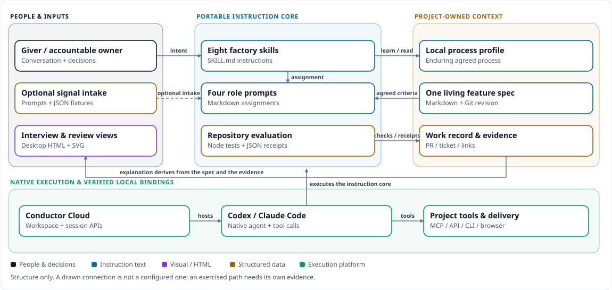
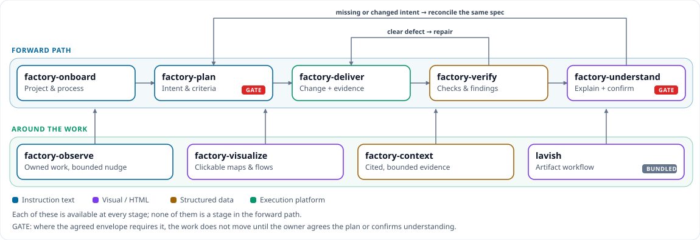
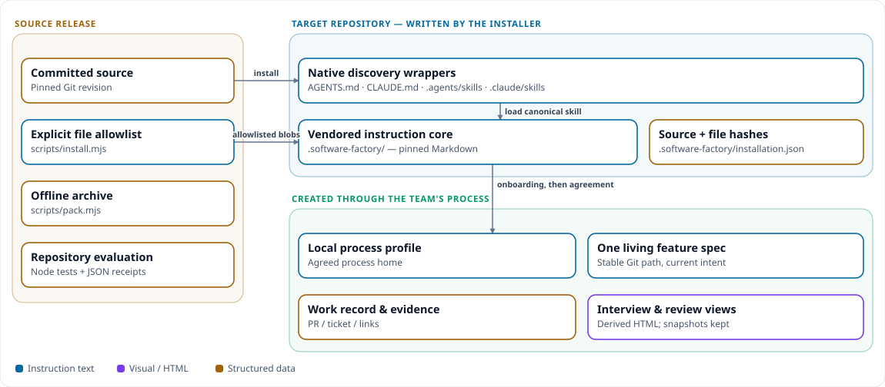

# Software Factory architecture

Software Factory is a portable instruction system. Seven skills and four role prompts guide native coding agents through alignment, delivery, verification and understanding. Conductor supplies the execution environment; the target repository supplies its process, product context and actual tools.

The HTML companion lets you select a component to inspect its interface, ownership and authority boundary, or filter by text, visual, structured and execution surfaces. The map describes system structure; configured connections and exercised paths require their own evidence.

## 1. System boundaries

Read the map in three parts: the portable instruction core, the project-owned context, and the existing execution platform. People provide intent and decisions. Agents load instructions and operate tools. The same local profile and current feature criteria govern each stage. HTML is a derived explanation and discussion surface.

| Component | Representation / interface | Responsibility and boundary | Source |
| --- | --- | --- | --- |
| Giver / accountable owner | Text conversation; visual review and actual scoped answers | Owns intent, consequential choices and acceptance. The receiving factory retains delivery responsibility. | [Portable contract](CONTRACT.md) |
| Seven skills | Markdown `SKILL.md`, discovered by the native harness | Select behavior and handoffs; these are instructions interpreted by agents, not deployed services. | [Skill catalog](../README.md#the-seven-skills) |
| Four role prompts | Markdown assignment context | Coordinator, worker, reviewer and observer roles. Name source/spec revision, criteria, owned files, checks, authority and stop conditions. | [Worker prompt](../prompts/worker.md) |
| Local process profile | Existing process document or `docs/FACTORY-PROFILE.md` | Enduring process, authority, stakes, checks and exact tool bindings; learned and agreed locally. | [Profile outline](../.agents/skills/factory-onboard/references/process-profile.md) |
| Feature specification | One stable Markdown path under Git | Current agreed intent, criteria and consequential product decisions. Revisions propagate to assignments, checks and explanations. | [Spec lifecycle](SPEC-LIFECYCLE.md) |
| Work record / PR | Ticket fields, prose, links and receipts | Assignments, current stage, actual human answers, history and verification evidence. Its vendor is learned, not fixed. | [Project connections](CONNECTIONS.md) |
| Interview / review views | Desktop HTML, SVG diagrams and interaction | Help people explore or explain current intent and evidence. Markdown remains authoritative; views do not themselves record agreement. | [HTML artifacts](HTML-ARTIFACTS.md) |
| Conductor Cloud | Workspace/session/transcript/preview surfaces; CLI/API | Hosts isolated execution and coordination. Workspace groups, ticket stages and runtime status mean different things. | [Native execution](NATIVE-EXECUTION.md) |
| Native harness | Codex or Claude Code; text context and tool calls | Reads instructions, edits files, runs commands and exposes its available continuation controls. Actual permissions remain decisive. | [Native execution](NATIVE-EXECUTION.md) |
| Local tool bindings | Existing MCP, API, CLI or browser access | Connect the team's work tracking, context, source code, CI and delivery process. Verify exact destination and allowed actions. | [Enablement](ENABLEMENT.md) |
| Evaluation tooling | Node tests, case definitions and JSON receipts | Tests the source kit and records versioned observations; it is development tooling, not a production orchestrator. | [Evaluations](../evals/README.md) |

The reusable core contains no target-company identity, product facts or mandatory ticket service. The source repository's own profile is its development policy and is not copied into installed targets. There is no factory-owned hosted application, resident daemon, connector platform or scheduler to deploy.

## 2. Skills and control flow

| Skill | Reads / receives | Produces / hands off | Human and visual interface |
| --- | --- | --- | --- |
| `factory-onboard` | Local instructions, existing conventions and the team's answers | One agreed local profile; selected components and verified bindings or explicit gaps | Interview and HTML process proposal before consequential process changes |
| `factory-plan` | Outcome, stakes, existing decisions and current spec | One living feature spec; bounded assignments tied to its agreed revision | Concrete examples, scoped questions and intent-delta views |
| `factory-deliver` | Assignment, accepted criteria, profile, owned files and checks | Bounded implementation, evidence and handoff | Raises surprises that would change the agreement |
| `factory-verify` | Actual change, current criteria and target checks | Check results, independent read-only findings and failure routing | States exactly which claims were or were not verified |
| `factory-understand` | Actual change, spec and verification evidence | Explanation, real questions/answers and agreed understanding checkpoint | Desktop HTML walkthrough, diagrams and discussion; no invented understanding pass |
| `factory-observe` | Owned work records, current criteria and new transcript messages | Evidence-based bounded nudge, hold or escalation | New actionable updates; native schedule receipt required before claiming recurrence |

A skill is a text instruction package. A role is a responsibility an agent takes. A session is a concrete execution context. A workspace isolates files and a branch. One session can perform multiple roles where independence permits; the skills do not require one agent each. Independent builders own separate file trees; reviewers remain read-only.

The forward path is input → establish intent/stakes → align → build → verify → understand → hand over. Handover follows the local review and acceptance process; merged, deployed, active and accepted remain separate facts.

Feedback has three different routes. A clear defect against agreed criteria returns to delivery and relevant checks. Missing or contradictory intent returns to planning and the accountable owner, with only affected work held. An explanation question returns to understanding first. Changed intent updates the same spec and propagates before dependent work resumes.

Observation surrounds active work rather than becoming a mandatory delivery stage. A goal supplies continuation, not a timer. Scheduling is delegated to available native controls; registration, successful observation and host lifetime require separate evidence. Prompts do not implement atomic cross-workspace enforcement.

## 3. Installation and artifact homes

The core installer is executable JavaScript; the operating behavior it installs is predominantly Markdown. `scripts/pack.mjs` builds a local offline archive from committed source. `scripts/install.mjs` installs from that source or packaged payload into an existing target Git repository.

| Location / artifact | Interface | Owned by / authority | Installed or produced later? |
| --- | --- | --- | --- |
| `AGENTS.md`, `CLAUDE.md` | Managed text block linking the portable contract | Existing local instructions are preserved | Core installer appends a bounded block |
| `.agents/skills/factory-*/SKILL.md` | Native discovery wrapper for Codex | Points to canonical installed skill | Core installer |
| `.claude/skills/factory-*/SKILL.md` | Native discovery wrapper for Claude Code | Points to the same canonical skill | Core installer; compatible shared directories supported |
| `.software-factory/.agents/skills/` | Six canonical Markdown skills and selected support files | Pinned portable kit | Core installer |
| `.software-factory/docs/`, `.software-factory/prompts/` | Allowlisted reference docs and four role prompts | Pinned portable kit | Core installer |
| `.software-factory/installation.json` | Source revision and per-file SHA-256 hashes | Installation receipt, not process authority | Core installer |
| Existing process home or `docs/FACTORY-PROFILE.md` | Agreed local Markdown process | Target team and accountable owner | Materialized through onboarding after agreement |
| Current feature spec | Git-versioned Markdown at one stable path | Agreed feature intent | Planning and scoped reconciliation |
| PR / ticket / work record | Assignment, history and evidence links | Existing project process | Throughout work |
| Markdown + HTML companions | Canonical prose plus derived highlighted view | Same source content; scoped decisions recorded separately | When creating or editing prose |

The installer reads an explicit allowlist of committed blobs, preserving source identity and excluding unrelated working-tree files. It preflights conflicts and supports exact repeat installation with zero writes. It does not silently upgrade conflicting local edits; partial I/O failure is not transactional. Installation does not establish native discovery, onboarding agreement, live connections or permission to build or release.

## 4. Cross-component contracts

| Contract | Sender → receiver | Shape and required information | Failure / waiting behavior |
| --- | --- | --- | --- |
| Delegation | Owner → receiving team | Outcome, stakes and mandate, with actual decision provenance | Ask only unresolved consequential questions; silence grants no authority |
| Process agreement | Onboarding → all stages | One local profile: authority, checks, bindings, selected process and checkpoint | Missing access stays explicit; continue independent preparation |
| Assignment | Manager → isolated builder | Spec path + agreed revision, criteria, owned paths, checks, budget and stop conditions | Hold affected work when intent changes; reconcile stale criteria |
| Verification | Builder/reviewer → work record | Actual command/result, change revision, reproduction and criterion evidence | Defect → repair; intent gap → alignment; broken tool → missing evidence |
| Explanation | Spec + change + checks → owner | Derived desktop HTML and source links; actual questions and answers | A page opening or prepared quiz is not an understanding pass |
| Tool binding | Local profile → native tools | Exact destination, permissions and allowed read/write actions | Unavailable write leaves a draft in the work record, not a claimed delivery |
| Observation | Native schedule → observer | Registered job/session, bounded run, cursors and current accepted criteria | No scheduler means an honest one-shot check; no invented recurrence |

For this source repository, Conductor is the decision surface and Slack is a notification surface. Installed teams learn their own choice. Notifications link back to the actual question; a channel reaction or delivered message does not establish agreement.

## 5. Optional inputs and extensions

The separately installed `signals/` kit provides Markdown triage, pull-manager and idea-scout prompts, a signal-specific JSON configuration and synthetic fixtures. Its configuration references the authoritative local process profile rather than replacing its decisions. It is excluded from the core installer's portable file allowlist.

An optional push path describes external event → webhook routine → fresh agent context with attached JSON. An optional pull path describes a verified native schedule prompting its existing manager session. Both require real setup and delivery receipts before being called active. A signal is evidence and cannot grant permissions. Prompt-level dedupe and caps do not supply atomic enforcement or bound platform-created workspaces.

Google Cloud is one possible event-source binding. Phone is one possible final escalation binding, only with explicit consent and a budget. Neither is required to install, onboard or run the core factory. Another team can use different inputs, its existing work queue and its agreed decision/notification surfaces. HydraDB is an optional derived retrieval index; previews can use an existing host. Canonical records retain authority.

## 6. Evidence and reading order

This architecture was traced from the committed installer allowlist, six canonical skills, four role prompts, operating contract, spec lifecycle, native-execution guidance and signal prompts at the pinned revision. It adds a documentation view and SVG assets; it activates no integration, scheduler or service. It does not claim new live deployment or agent-behavior evidence.

Read [installation](../INSTALL.md), then [the contract](CONTRACT.md), [operating model](OPERATING-MODEL.md), [local enablement](ENABLEMENT.md), [spec lifecycle](SPEC-LIFECYCLE.md) and [native execution](NATIVE-EXECUTION.md). Use the HTML inspector for component-level source links. The architecture page is a review artifact, not a new runtime or source of project-specific authority.
