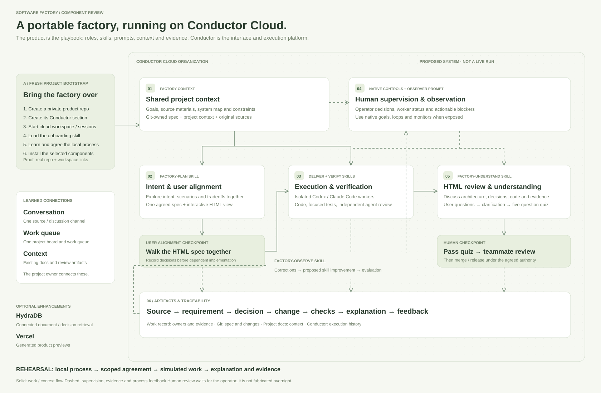

# Operating model

Software Factory supplies a responsible receiving team through instructions, skills and prompts.
Conductor provides cloud workspaces, sessions, transcripts and previews; native coding harnesses
provide execution and their available continuation controls. No additional execution service or
factory application UI is required.

## Bring the factory into a repository

`factory-onboard` reads local instructions and interviews the team. It produces one local process
profile and a reviewable selection of skills/roles/prompts, preserving existing governance.
Product knowledge and tool identities stay in that repository. Use a pinned factory version and
keep referenced guidance resolvable when installing selected files.

For a fresh project, create its repository and Conductor section/workspace only within the
assignment's authority. Verify repository creation and cloud access before relying on unattended
bootstrap; do not silently depend on an offline operator's Mac. Actual links prove bootstrap.

Onboarding learns the team's alignment, notification, work queue and context tools through
[project bindings](CONNECTIONS.md). Slack, Linear and Docs/Drive are examples. Verify the exact
destination and required actions in the environment doing the work; naming a tool is not access.

## Components and roles

| Role             | Owns                                                                          |
| ---------------- | ----------------------------------------------------------------------------- |
| Giver / operator | Intent, consequential decisions and acceptance within their authority.        |
| Manager          | Alignment, canonical spec, bounded assignments, dependencies and integration. |
| Builder          | One slice in an isolated workspace, its evidence and explanation.             |
| Reviewer         | Independent read-only inspection of the actual change and criteria.           |
| Observer         | Evidence-based inspection and bounded nudges of owned work.                   |

Roles do not require separate sessions unless distinct work or independence warrants one.
One writer owns each file tree. The receiving factory remains accountable for delivery and
explanation; the giver's understanding does not transfer correctness work to them.

## Work and feedback

**Input → intent and stakes → alignment → build → verify → understand → hand over.**

`factory-plan` calibrates rigor by consequences, dependencies and replacement cost. A change
may contain both disposable and indispensable parts. Build uses `factory-deliver`; checks and
independent inspection use `factory-verify`; explanation and human discussion use
`factory-understand`. The project profile sets review, merge and release authority.

An explanation question returns to explanation. A clear defect returns to repair. Missing or
contradictory intent returns to alignment. Apply [the spec lifecycle](SPEC-LIFECYCLE.md): hold
affected work, show the smallest decision delta, record the actual scoped answer, and update the
same spec plus affected assignments/evidence/views. Independent work and unaffected evidence remain useful.

The [HTML artifact contract](HTML-ARTIFACTS.md) defines interactive interviews and reviews.
The supplied playbook offers five change-specific questions before teammate code review; the
local understanding checkpoint must be agreed. Prepared questions, opened pages and silence
do not constitute a human pass.

## Persistence and execution

Keep enduring process in the project profile, current feature intent in one Git-owned spec,
and assignment/decision history/evidence in the work record or PR. HTML is a derived view;
preserve a snapshot when a decision depends on it. Update existing product reference pages
instead of accumulating session reports.

Follow [native execution](NATIVE-EXECUTION.md) for manager/builders, ticket access, five-minute
observation, safe nudging and recovery. A goal supplies continuation, not timing or additional
authority. An unavailable scheduler means an honest one-shot check. Record actual registrations
and invocations before claiming monitoring. Rehearsals do not establish guaranteed enforcement.

[HydraDB retrieval](SPEC-LIFECYCLE.md#optional-context-retrieval) can help find related sources
and decisions; canonical records retain authority. Vercel can host product previews. Neither
optional service is required for the instruction workflow.
